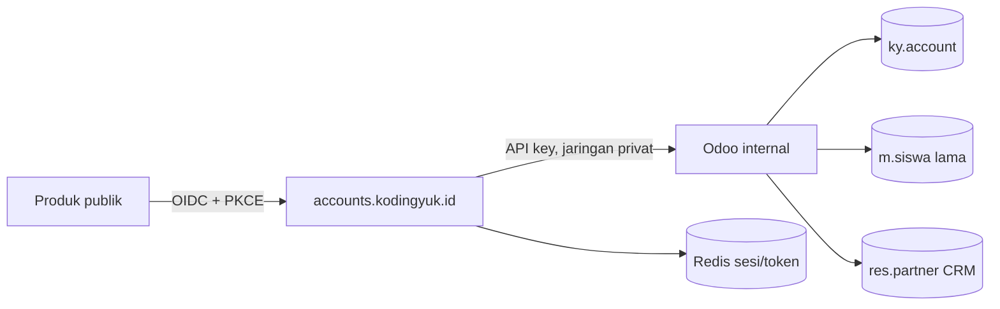

# Deployment Accounts KodingYuk

## Topologi



Tidak ada request browser publik yang membawa API key Odoo. Hanya container web
SSO yang mengetahui secret tersebut. Odoo boleh tetap berada di jaringan privat
atau dilindungi allowlist/reverse proxy.

## 1. Install modul Odoo

1. Masukkan `odoo_addons` ke `addons_path` Odoo 17.
2. Pastikan modul existing `students` sudah terpasang.
3. Update Apps List dan install **KodingYuk Accounts**.
4. Buat system parameter `accounts.api_key` dengan secret acak minimal 32 byte.
5. Biarkan `accounts.allow_direct_student_claim=False` untuk pilot.
6. Beri grup **Accounts Viewer** atau **Accounts Manager** hanya kepada tim yang
   membutuhkan. Akun publik tidak mendapat grup dan tidak menjadi `res.users`.

## 2. Daftarkan aplikasi client

Di menu **KodingYuk Accounts → OIDC Clients**, buat satu client per aplikasi.
Gunakan redirect URI exact, misalnya:

| Produk | Client ID | Redirect URI contoh |
|---|---|---|
| Website ujian | `student-exam-web` | `https://ujian.kodingyuk.id/auth/callback` |
| KodyHost | `kodyhost-web` | `https://kodyhost.com/auth/callback/kodingyuk` |
| KodyBlocks | `kodyblocks-web` | `https://kodyblocks.com/auth/callback` |
| KodyBlocks Jr | `kodyblocks-jr-web` | `https://jr.kodyblocks.com/auth/callback` |

Jangan memakai wildcard redirect URI. Client browser/public memakai
Authorization Code + PKCE dan `token_endpoint_auth_method=none`.

## 3. Konfigurasi web

Salin `.env.example` menjadi `.env`, lalu isi:

- `PUBLIC_ORIGIN=https://accounts.kodingyuk.id`
- `ODOO_BASE_URL` ke origin Odoo (tanpa path `/web`)
- `ODOO_ACCOUNTS_API_KEY` sama dengan parameter Odoo
- `REDIS_URL=redis://redis:6379/0` untuk Compose
- `COOKIE_KEYS`: minimal dua secret random, masing-masing ≥32 karakter
- `OIDC_JWKS`: private JWKS tetap; simpan sebagai secret deployment

Generate signing JWKS sekali dengan `npm run generate:jwks`, lalu simpan output
sebagai secret `OIDC_JWKS` (jangan commit ke Git). Jangan memakai ephemeral
development key di production karena token lama akan gagal diverifikasi setelah
restart.

Jalankan:

```powershell
docker compose up -d --build
```

Pasang reverse proxy HTTPS ke `127.0.0.1:3000`, kemudian cek:

- `https://accounts.kodingyuk.id/health`
- `https://accounts.kodingyuk.id/.well-known/openid-configuration`
- issuer harus persis `https://accounts.kodingyuk.id`
- `code_challenge_methods_supported` harus memuat `S256`

## 4. Backup dan rollback

- Backup database Odoo dan volume Redis sebelum rollout.
- Modul hanya menambah tabel `ky_*`, relasi ke `m.siswa`, dan `res.partner` baru
  bila kontak email belum ada. Tidak mengubah atau menghapus siswa lama.
- Jangan uninstall modul sebagai cara rollback karena uninstall Odoo menghapus
  tabel milik modul. Rollback aplikasi dilakukan dengan menghentikan redirect SSO
  dan kembali ke login legacy; data baru tetap disimpan.
- Endpoint dan login legacy dipertahankan selama fase dual-read. Penghapusan baru
  boleh dilakukan setelah rekonsiliasi, backup teruji, dan sign-off bisnis.

## Cakupan final V1

V1 menyediakan register, verifikasi email, login, lupa/reset password, consent,
OIDC, claim kode siswa berstatus pending, registry client, dan session/token Redis.
Google login tidak dibutuhkan untuk V1. Claim siswa production memakai approval
admin; OTP wali dapat ditambahkan sebagai hardening fase berikutnya tanpa mengubah
model akun atau data siswa.
