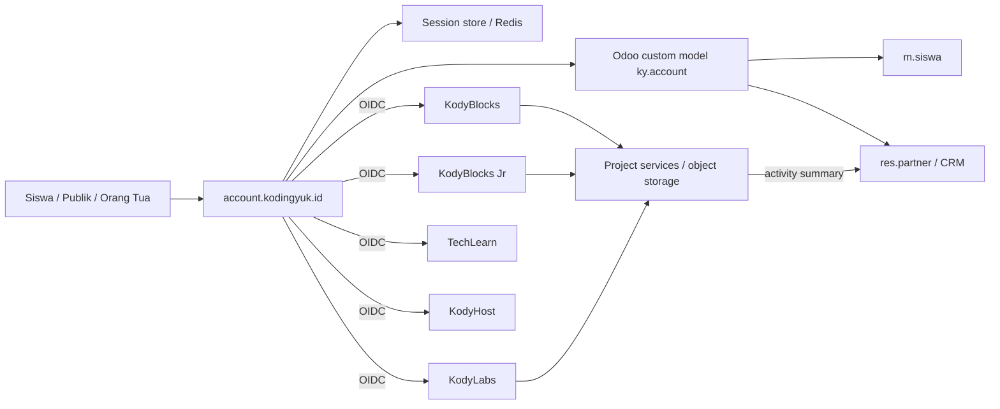

# PRD — Accounts KodingYuk & SSO Publik

## 1. Ringkasan

> Implementasi final V1 2026-07-13 mencakup addon Odoo, register, verifikasi
> email, login, lupa/reset password, consent, registry client, Redis adapter,
> OIDC Authorization Code + PKCE, dan student claim dengan approval admin.

Accounts KodingYuk adalah layanan identitas publik di
`https://account.kodingyuk.id` untuk siswa, orang tua, dan pengguna umum.
Layanan menyediakan satu akun dan satu sesi login untuk seluruh produk publik
KodingYuk, termasuk KodyBlocks, KodyBlocks Jr, KodyLabs, TechLearn, Student
Dashboard, dan KodyHost.

Odoo tetap menjadi aplikasi internal tim. Akun publik tidak dibuat sebagai
`res.users`. Data autentikasi disimpan pada model khusus `ky.account`, mengikuti
pola `ky.client` KodyHost dan `lms.user` TechLearn. Data master siswa tetap berada
pada `m.siswa` di modul `students`.

## 2. Latar belakang

Repository saat ini memiliki beberapa sistem identitas yang berjalan terpisah:

- `m.siswa.access_code` (`ST-XXXXXX`) untuk Student Dashboard.
- Endpoint publik yang membuat Odoo portal `res.users`.
- `ky.client` untuk KodyHost.
- `lms.user` untuk TechLearn.
- Firebase access code untuk KodyLabs.
- Guest/local-only storage di KodyBlocks dan KodyBlocks Jr.

Akibatnya, satu orang dapat memiliki beberapa password, profil, dan identifier.
Data aktivitas sulit digabungkan untuk pelayanan siswa, dukungan pelanggan,
analitik produk, dan marketing yang memiliki consent.

## 3. Sasaran produk

1. Satu akun KodingYuk dapat digunakan di seluruh produk publik.
2. Odoo tidak mengekspos login internal kepada siswa/publik.
3. Master siswa `m.siswa` dan kode `ST-` yang sudah ada tetap digunakan.
4. Akun publik, akun siswa, orang tua, dan client hosting dapat dihubungkan tanpa
   membuat duplikasi kontak.
5. Aplikasi dapat menyimpan project dan aktivitas berdasarkan global account ID.
6. Tim internal dapat melihat profil terpadu, sumber akuisisi, produk yang dipakai,
   dan consent di Odoo.
7. Integrasi memakai standar OAuth 2.0/OpenID Connect agar tidak membuat mekanisme
   login khusus untuk setiap aplikasi.

## 4. Non-sasaran

- Menggantikan login staff Odoo.
- Memindahkan game/project binary ke database Odoo.
- Mengganti model master siswa `m.siswa`.
- Membuat kode siswa baru untuk menggantikan `nis` atau `access_code`.
- Menggabungkan seluruh database domain produk menjadi satu database.
- Menjalankan campaign marketing tanpa consent yang sah.
- Mengimplementasikan seluruh migrasi aplikasi dalam MVP pertama.

## 5. Keputusan arsitektur

### 5.1 Odoo tetap internal, akun publik memakai custom model

Untuk MVP, “database terpisah” berarti tabel/model autentikasi eksternal yang
terpisah secara logis dari `res.users`, tetapi masih berada pada PostgreSQL Odoo
agar pola operasionalnya konsisten dengan `ky.client` dan `lms.user`.

Model utama yang diusulkan adalah `ky.account`. Pengguna tidak memperoleh session
Odoo dan tidak bisa membuka backend Odoo. Semua akses dilakukan melalui API
Accounts KodingYuk.

Jika beban autentikasi kelak terlalu tinggi, model ini dapat dipindahkan ke
identity database fisik terpisah tanpa mengubah kontrak OIDC kepada aplikasi.

### 5.2 Source of truth

| Data | Source of truth |
|---|---|
| Login, password hash, email verification, provider sosial | `ky.account` |
| Master siswa, enrollment, ujian, absensi | `m.siswa` dan model akademik Odoo |
| Nomor induk siswa | `m.siswa.nis` jika digunakan operasional |
| Kode akses siswa yang dapat dirotasi | `m.siswa.access_code` |
| Kontak/CRM/billing | `res.partner` |
| Service hosting | model KodyHost (`ky.service`, dst.) |
| Course enrollment LMS | model LMS/TechLearn |
| Game/project | database/object storage masing-masing produk |
| Session/token SSO | Accounts service + Redis/session store |
| Consent yang dapat diaudit | `ky.account.consent` dan ringkasan pada partner |

### 5.3 Kode siswa yang sudah ada

Tidak dibuat `student_code` baru.

- `nis` diperlakukan sebagai nomor administrasi siswa bila sudah diisi.
- `access_code` dengan prefix `ST-` diperlakukan sebagai credential sementara
  yang dapat dirotasi, bukan primary key dan bukan identifier publik permanen.
- `m.siswa.id` tetap internal Odoo dan tidak diekspos sebagai global user ID.
- `ky.account.id`/`sub` menjadi identifier global untuk aplikasi.
- Kode enrollment lama tetap dibaca selama masa kompatibilitas, lalu dihentikan.

Penggunaan target kode `ST-`:

1. Aktivasi akun siswa yang sudah dibuat oleh tim.
2. Menautkan akun ke record `m.siswa` setelah verifikasi tambahan.
3. Fallback terkontrol untuk Student Dashboard selama migrasi.
4. Dapat dinonaktifkan atau dirotasi tanpa mengganti akun.

Kode `ST-` tidak boleh menjadi satu-satunya faktor untuk mengambil alih akun yang
sudah terhubung. Setelah link pertama, diperlukan login akun atau pemulihan oleh
orang tua/admin.

## 6. Pengguna dan role

| Persona | Kebutuhan utama |
|---|---|
| Publik/guest | Mencoba produk, membuat akun, menyimpan project |
| Siswa | Masuk ke aplikasi belajar, project, ujian, dan portofolio |
| Orang tua/wali | Mengelola consent dan beberapa profil anak |
| Client KodyHost | Mengelola hosting, domain, invoice, dan support |
| Admin akademik | Menautkan siswa, membantu recovery, melihat status sinkronisasi |
| Marketing | Segmentasi hanya berdasarkan consent dan data minimum yang relevan |

Role akun bukan pengganti authorization di aplikasi. Produk tetap memutuskan hak
akses berdasarkan entitlement/claim yang diterima.

## 7. User journey

### 7.1 Register pengguna umum

1. Pengguna memilih “Daftar dengan KodingYuk”.
2. Accounts meminta nama, email, password, dan verifikasi email; Google dapat
   ditambahkan sebagai alternatif.
3. Accounts membuat `ky.account` dan menautkan/membuat `res.partner` yang tepat.
4. Consent layanan wajib dipisahkan dari consent marketing opsional.
5. Pengguna kembali ke aplikasi asal melalui authorization code.
6. Aplikasi menerima `sub` dan membuat profil lokal bila belum ada.

### 7.2 Aktivasi siswa yang sudah ada

1. Siswa/orang tua memilih “Saya sudah siswa KodingYuk”.
2. Masukkan kode `ST-` yang berasal dari `m.siswa.access_code`.
3. Sistem menemukan `m.siswa` tanpa mengekspos detail sensitif.
4. Sistem meminta verifikasi tambahan: OTP email orang tua, persetujuan admin, atau
   flow lain sesuai kelengkapan data produksi.
5. Sistem membuat link `ky.account.student.link`.
6. Kode dapat dirotasi atau ditandai telah diklaim sesuai kebijakan.

### 7.3 Satu orang tua, beberapa anak

Satu `ky.account` orang tua dapat terhubung ke beberapa `m.siswa`. Setiap link
menyimpan relationship dan status consent. Anak dapat memiliki akun sendiri yang
terhubung ke record siswa yang sama tanpa menyatukan password orang tua dan anak.

### 7.4 SSO lintas aplikasi

1. Pengguna membuka KodyBlocks Jr dan memilih masuk.
2. Aplikasi mengarahkan ke endpoint OIDC Accounts KodingYuk.
3. Jika session pusat masih aktif, pengguna tidak mengisi password lagi.
4. Accounts mengembalikan authorization code ke redirect URI terdaftar.
5. Aplikasi menukar code menggunakan PKCE dan menerima token.
6. Project service menyimpan project menggunakan `sub`, bukan email atau kode
   `ST-`.

### 7.5 Guest menjadi akun

KodyBlocks/KodyBlocks Jr tetap dapat dipakai tanpa akun. Saat guest login:

1. Aplikasi menampilkan daftar project lokal.
2. Pengguna memilih project yang akan diunggah.
3. Project mendapat owner `sub` dan versi cloud pertama.
4. Project lokal tidak dihapus sampai upload terverifikasi.

## 8. Model data usulan

### 8.1 `ky.account`

| Field | Keterangan |
|---|---|
| `id` | ID internal Odoo |
| `subject_uuid` | UUID immutable, unik, menjadi OIDC `sub` |
| `username` | Opsional, unik case-insensitive |
| `email` | Opsional untuk akun anak tertentu; unik case-insensitive bila ada |
| `password_hash` | Hash Argon2id atau PBKDF2 yang dikonfigurasi aman |
| `name` | Nama tampilan |
| `account_type` | `public`, `student`, `guardian`, `client` |
| `status` | `pending`, `active`, `suspended`, `deleted` |
| `email_verified_at` | Waktu verifikasi |
| `partner_id` | Relasi ke `res.partner`, opsional sesuai tipe akun |
| `locale`, `timezone` | Preferensi dasar |
| `created_source` | Aplikasi/campaign asal |
| `last_login_at` | Ringkasan login terakhir |

Constraint:

- `subject_uuid` selalu unik dan tidak boleh berubah.
- Email dinormalisasi lowercase dan dicek case-insensitive.
- Username memakai reserved-word list dan rate limit saat pengecekan.
- Password mentah tidak pernah disimpan atau masuk log/chatter.

### 8.2 `ky.account.student.link`

| Field | Keterangan |
|---|---|
| `account_id` | Akun KodingYuk |
| `student_id` | Many2one ke `m.siswa` |
| `relationship` | `self`, `parent`, `guardian` |
| `status` | `pending`, `verified`, `revoked` |
| `verified_method` | `student_access_code`, `guardian_otp`, `admin` |
| `verified_at` | Audit waktu verifikasi |

Unique constraint pada pasangan akun dan siswa. Satu siswa dapat memiliki link
akun anak dan akun wali, sehingga relasi tidak boleh dipaksa one-to-one.

### 8.3 `ky.account.identity`

Menyimpan provider eksternal seperti Google: `provider`, `provider_subject`,
`account_id`, timestamps. Password placeholder untuk akun Google dilarang.

### 8.4 `ky.account.consent`

Menyimpan `account_id`, opsional `student_id`, purpose, channel, status, actor,
policy version, source, timestamp, dan evidence reference. Consent email,
WhatsApp, event, publikasi project anak, serta terms/privacy harus terpisah.

### 8.5 `ky.oauth.client`

Registry aplikasi: client ID, redirect URI exact-match, allowed grant, scopes,
logout URI, environment, owner, dan status. Secret hanya untuk confidential
clients dan disimpan sebagai hash/encrypted secret sesuai kebutuhan.

## 9. Claim dan scope OIDC

Minimal identity token:

```json
{
  "sub": "0fbc7b6d-...",
  "iss": "https://account.kodingyuk.id",
  "aud": "kodyblocks-jr-web",
  "name": "Budi",
  "account_type": "student"
}
```

Scope awal:

| Scope | Isi |
|---|---|
| `openid` | Wajib OIDC |
| `profile` | Nama tampilan dan preferensi minimum |
| `email` | Email hanya jika ada dan dibutuhkan client |
| `student.basic` | Status siswa dan reference opaque, tanpa data akademik rinci |
| `guardian.children` | Daftar child reference untuk dashboard wali yang berwenang |
| `projects` | Izin project service atas nama pengguna |
| `offline_access` | Refresh token hanya untuk client yang disetujui |

Kode `ST-`, password hash, ID database Odoo, data orang tua, dan consent evidence
tidak boleh masuk token.

## 10. Endpoint minimum

OIDC/OAuth:

```text
GET  /.well-known/openid-configuration
GET  /oauth/authorize
POST /oauth/token
GET  /oauth/userinfo
GET  /.well-known/jwks.json
POST /oauth/revoke
GET  /oauth/logout
```

Account experience:

```text
POST /api/register
POST /api/email/verify
POST /api/password/forgot
POST /api/password/reset
POST /api/student/claim
GET  /api/me
GET  /api/me/products
GET  /api/me/students
POST /api/me/consents
DELETE /api/me/session/:id
```

Internal integration:

```text
POST /internal/accounts/sync-partner
POST /internal/students/link
POST /internal/events/summary
```

Endpoint internal memakai service credential terpisah per aplikasi, allowlist,
least privilege, audit log, rate limit, dan idempotency key.

## 11. Arsitektur logis



## 12. Penyimpanan project dan sharing

Odoo hanya menyimpan metadata bisnis/portofolio, bukan file editor utama.

Project service minimal menyimpan:

- `project_id` UUID.
- `owner_sub` dari Accounts KodingYuk.
- `product_code`.
- judul, thumbnail URL, format/schema version.
- object storage key.
- visibility: `private`, `unlisted`, `public`.
- share slug/token yang dapat dirotasi.
- timestamps dan soft-delete.

Publikasi project anak harus melalui aturan moderasi dan consent yang terpisah.
Share URL tidak boleh mengungkap email, kode siswa, atau ID `m.siswa`.

## 13. Sinkronisasi Odoo dan marketing

Accounts memperbarui `res.partner` secara idempotent dan menyimpan reference
`subject_uuid`. Odoo menerima ringkasan yang berguna, misalnya:

- produk yang pernah digunakan;
- tanggal aktivitas terakhir per produk;
- jumlah project/publish agregat;
- acquisition source/campaign;
- cabang/program dari relasi siswa;
- status consent per channel.

Raw clickstream tidak dikirim ke Odoo. Event volume tinggi masuk analytics/event
store, lalu hanya agregatnya disinkronkan ke CRM.

Segmentasi marketing harus memeriksa consent dan actor yang sah. Untuk akun anak,
target komunikasi default adalah wali yang terverifikasi, bukan anak, kecuali
kebijakan dan dasar pemrosesannya sudah ditetapkan.

## 14. Persyaratan keamanan dan privasi

1. Authorization Code Flow + PKCE untuk web/mobile/public clients.
2. Password hash Argon2id atau konfigurasi PBKDF2 yang kuat; tidak ada plaintext.
3. Access token pendek; refresh token rotation dan reuse detection.
4. Cookies Accounts memakai `HttpOnly`, `Secure`, dan `SameSite` yang sesuai.
5. Exact-match redirect URI; tidak menerima wildcard production.
6. Rate limit login/register/reset/student claim dan deteksi brute force kode
   `ST-`.
7. Generic error untuk login/recovery agar tidak membocorkan keberadaan akun.
8. Audit log untuk login, link siswa, consent, reset, admin override, dan revoke.
9. Admin tidak dapat melihat password atau token.
10. Data anak diminimalkan; tanggal lahir tidak dijadikan credential login.
11. Self-service logout semua perangkat, ekspor data, koreksi, dan penghapusan
    sesuai retention/legal hold.
12. Secret service tidak ditaruh di frontend/mobile bundle.

Pemrosesan data pribadi anak dan consent wali harus melalui review legal sebelum
go-live. PRD ini bukan pendapat hukum.

## 15. Migrasi sistem yang sudah ada

### Fase 0 — Persiapan dan perbaikan risiko

- Audit isi field `m.siswa.password` di production tanpa menyalin nilainya ke log.
- Bekukan penggunaan baru endpoint register publik berbasis `res.users`.
- Tetapkan definisi operasional `nis` versus `access_code`.
- Bersihkan collision email pada `res.partner`, `ky.client`, dan `lms.user`.
- Buat identifier mapping dan prosedur merge manual.

### Fase 1 — Accounts core

- Modul Odoo model `ky.account` dan relasi pendukung.
- Web Accounts untuk register, login, verification, recovery, profile, consent.
- OIDC discovery, authorize/token/userinfo/JWKS/logout.
- Client registry, signing key rotation, Redis session, audit log.
- Admin internal untuk search, suspend, link/unlink, dan recovery terbatas.

### Fase 2 — Pilot KodyBlocks Jr

- Guest tetap berjalan.
- Tambahkan tombol masuk dan import project local ke cloud.
- Daftarkan OIDC client `kodyblocks-jr-web`.
- Uji siswa baru, siswa existing `ST-`, orang tua, dan logout lintas session.
- Jangan meneruskan rencana relay kode siswa khusus yang ada di PRD lama; gunakan
  Accounts sebagai satu gateway.

### Fase 3 — Student Dashboard dan KodyLabs

- Student Dashboard menukar login kode menjadi session akun.
- Selama transisi, endpoint `ST-` lama tetap aktif dengan telemetry dan batas
  waktu deprecation.
- KodyLabs mengganti Firebase auth code sebagai primary auth dengan OIDC.
- Role/program Firebase dimigrasikan menjadi entitlement aplikasi.

### Fase 4 — KodyHost dan TechLearn

- Buat mapping `ky.client.account_id` dan `lms.user.account_id`.
- Existing password diverifikasi pada sistem lama saat login pertama, lalu akun
  pusat dibuat/link tanpa mengetahui password mentah.
- Google identity dipetakan berdasarkan verified provider subject, bukan email
  saja.
- Service hosting, invoice, LMS enrollment, XP, dan badge tidak dipindahkan ke
  `ky.account`.
- Setelah cakupan migrasi tercapai, endpoint auth silo dihentikan bertahap.

### Fase 5 — Produk berikutnya

- KodyBlocks, website utama, EduTrack, dan KodyVerse.
- Standard SDK/helper untuk React, Next.js, Flutter, dan mobile PKCE.
- Dashboard konsolidasi project dan produk di Accounts.

## 16. Kompatibilitas dan deprecation

| Mekanisme lama | Status target |
|---|---|
| `m.siswa.access_code` | Dipertahankan sebagai claim/fallback, bukan password utama |
| Enrollment access code | Read-only compatibility lalu dihentikan |
| Public `res.users` register | Dihentikan setelah migrasi |
| `m.siswa.password` | Tidak digunakan; audit lalu hapus melalui migration |
| `ky.client` auth | Bridge kemudian ditautkan ke `ky.account` |
| `lms.user` auth | Bridge kemudian ditautkan ke `ky.account` |
| Firebase access code KodyLabs | Menjadi entitlement/migrasi, bukan central login |

Setiap deprecation memerlukan telemetry, komunikasi pengguna, rollback plan, dan
tanggal penghentian yang eksplisit.

## 17. Persyaratan fungsional MVP

### Akun

- Register email/password.
- Verifikasi email.
- Login/logout dan lupa/reset password.
- Google Login dapat masuk MVP jika konfigurasi consent siap.
- Profil dasar dan daftar session/perangkat.
- Suspend dan revoke oleh admin.

### Siswa

- Claim `m.siswa` menggunakan `ST-` + verifikasi tambahan.
- Satu wali dapat terhubung ke beberapa siswa.
- Satu siswa dapat terhubung ke akun self dan wali.
- Admin dapat menyelesaikan kasus mismatch dengan audit trail.
- Tidak membuat `m.siswa` baru saat register akun publik.

### SSO

- OIDC discovery dan JWKS publik.
- Authorization code + PKCE.
- Consent screen per client/scope jika diperlukan.
- Single logout dari Accounts dan revoke refresh token.
- Client pilot KodyBlocks Jr.

### CRM

- Link/create partner secara idempotent.
- Simpan acquisition source dan product registration.
- Consent versioned dan dapat dicabut.
- Ringkasan aktivitas pilot masuk ke Odoo.

## 18. Non-functional requirements

| Area | Target awal |
|---|---|
| Availability | 99,9% bulanan setelah production stabil |
| Login latency | p95 < 1,5 detik di luar waktu provider sosial |
| Token endpoint | p95 < 500 ms |
| Recovery | RPO ≤ 24 jam, RTO ≤ 4 jam untuk MVP; dipertajam sebelum scale |
| Audit retention | Ditentukan bersama legal/security sebelum go-live |
| Browser | Dua versi terbaru Chrome, Edge, Safari, Firefox |
| Mobile | PKCE dan secure storage untuk refresh token |
| Accessibility | Alur utama keyboard-accessible; pesan sederhana untuk anak/orang tua |
| Localization | Indonesia sebagai default; struktur siap untuk Inggris |

## 19. Metrik keberhasilan

- Persentase akun yang berhasil menyelesaikan register dan verifikasi.
- Persentase siswa existing yang berhasil claim tanpa bantuan admin.
- Login success rate dan reset-password completion rate.
- Jumlah identity collision/merge per 1.000 registrasi.
- Persentase pengguna pilot dengan project cloud yang berhasil dipulihkan.
- Jumlah akun ganda KodyHost/LMS yang berhasil dipetakan.
- Penurunan pemakaian endpoint login lama.
- Zero siswa publik baru yang dibuat sebagai `res.users` setelah cutover.
- Zero pengiriman marketing di luar consent aktif.

## 20. Acceptance criteria pilot

1. Pengguna dapat register, verifikasi, login, logout, dan reset password.
2. Siswa dengan kode `ST-` valid dapat menautkan akun tanpa membuat record
   `m.siswa` baru.
3. Kode invalid/nonaktif tidak mengungkap data siswa.
4. Orang tua dapat menautkan dua siswa berbeda ke satu akun.
5. KodyBlocks Jr menerima OIDC token dan menyimpan project cloud berdasarkan
   `sub`.
6. Project guest dapat diimpor tanpa kehilangan copy lokal ketika upload gagal.
7. Login SSO aktif dapat dipakai kembali tanpa memasukkan password.
8. Logout/revoke mencegah refresh token lama digunakan kembali.
9. Odoo menampilkan link account–student–partner dan consent audit.
10. Tidak ada password mentah, kode `ST-`, atau secret service di log aplikasi.
11. `res.users` tidak bertambah akibat register publik pilot.
12. Test mencakup account enumeration, brute force/rate limit, redirect URI,
    cross-account project access, dan guardian authorization.

## 21. Risiko dan mitigasi

| Risiko | Mitigasi |
|---|---|
| Email sama dipakai orang tua dan siswa | Model link many-to-many; jangan paksa one-email-one-student |
| `ST-` tersebar atau mudah ditebak | Rate limit, rotate, verifikasi tambahan, claim audit |
| Duplikasi `ky.client`/`lms.user`/partner | Mapping table, dry-run report, merge queue manual |
| Odoo menjadi bottleneck login | Cache key/discovery, Redis session, endpoint tipis, observability; opsi physical DB split |
| Token bocor di SPA/mobile | PKCE, short-lived token, secure storage, refresh rotation |
| Project publik anak mengandung PII | Default private, moderation, consent publikasi, report/takedown |
| Migrasi memutus KodyHost/LMS | Dual-read bridge, feature flag, staged rollout, rollback |
| Marketing memakai data tanpa dasar | Consent purpose/channel terpisah dan enforcement pada export/campaign |

## 22. Dependensi

- Modul Odoo `students` dan data `m.siswa` yang bersih.
- Modul KodyHost `ky-dev-odoo` untuk mapping `ky.client`.
- Modul TechLearn untuk mapping `lms.user`.
- Domain, TLS, SMTP transactional, Redis, database backup, dan secret manager.
- Object storage/project service untuk cloud save pilot.
- Review legal/privacy untuk data anak dan consent wali.
- Keputusan produk tentang username anak dan metode verifikasi wali.

## 23. Keputusan yang perlu dikonfirmasi sebelum implementation

1. Apakah akun anak wajib memiliki email sendiri, atau boleh username-only dengan
   recovery melalui wali?
2. Apakah `nis` sudah konsisten dan unik di production, atau hanya `access_code`
   yang saat ini benar-benar tersedia untuk semua siswa?
3. Metode verifikasi tambahan saat claim `ST-`: OTP wali, approval admin, atau
   kombinasi berdasarkan data yang tersedia?
4. Provider sosial MVP: Google saja atau email/password terlebih dahulu?
5. Apakah model `ky.account` dibuat pada modul Odoo baru atau sebagai hasil
   refactor `ky.client`? Rekomendasi: modul baru agar domain hosting tidak bocor ke
   seluruh produk.
6. Project service pilot memakai Firebase yang sudah ada atau service/object
   storage baru?

## 24. Referensi repository

- `students/models/m_siswa.py`
- `students/controllers/student_api.py`
- `student_dashboard/lib/viewmodels/auth_viewmodel.dart`
- `ky-dev/src/auth.ts`
- `ky-dev-odoo/models/ky_otp.py`
- `ky-dev-odoo/controllers/auth.py`
- `learning area/techlearn/kodingyuk_lms/models/lms_user.py`
- `learning area/techlearn/kodingyuk_lms/controllers/api.py`
- `ky_labs/src/store/useAuthStore.ts`
- `ky_labs/src/lib/auth/authCodes.ts`
- `kodyblocksjr-2026/prd.md`
- `kodyblocks/app/src/lib/project-saver-hoc.jsx`
- `docs/REPOSITORY-AUDIT.md`
